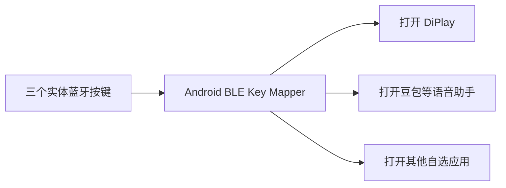
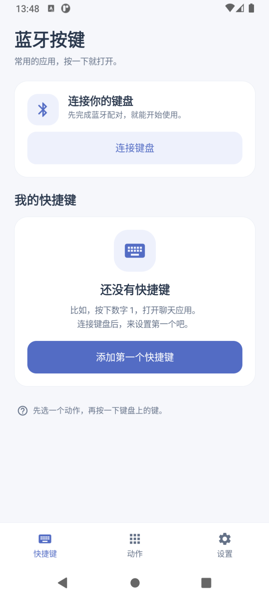
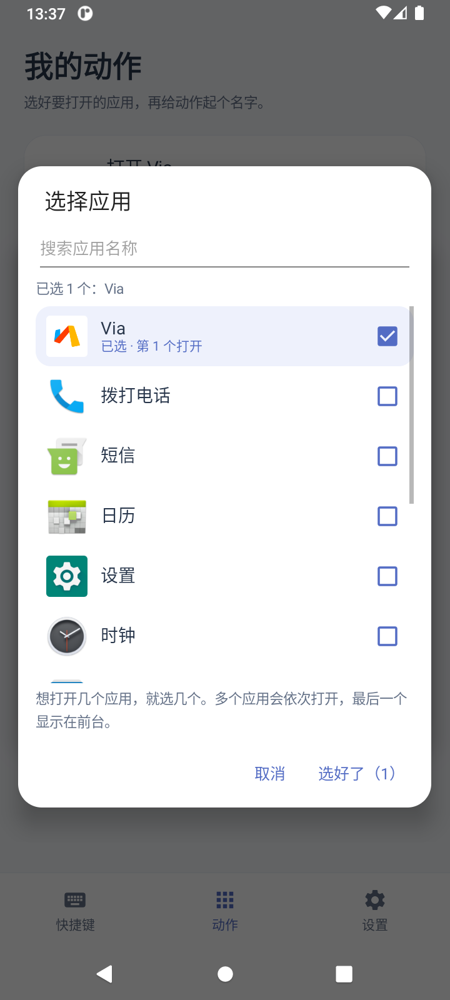
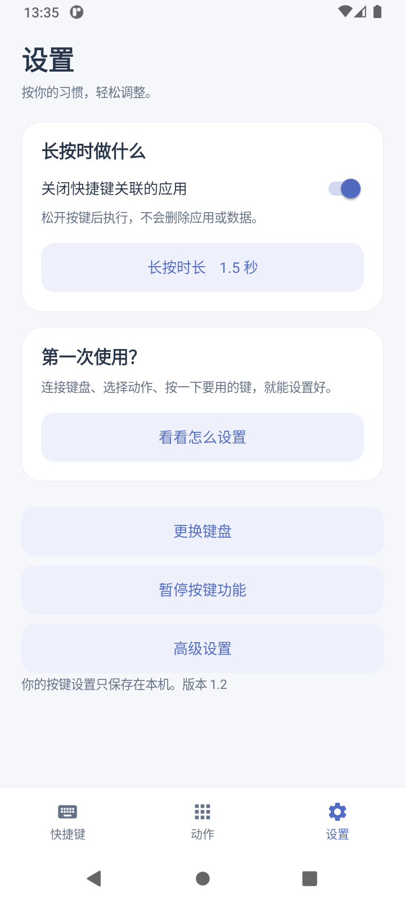

# Android BLE Key Mapper

**Map Bluetooth keyboard and button presses to Android apps and actions.**

把蓝牙键盘、宏键盘或独立按键，变成打开常用应用的快捷入口。先连接设备，选择想执行的动作，再按一下实体键完成绑定。

当前版本 **v1.2** · 原生 Android Java · 中文界面 · [MIT License](LICENSE)

## 为什么做这个项目

最初想在手机上使用常驻语音唤醒，随时叫出需要的应用。但在实际使用中，持续监听带来的资源占用和手机发热影响了体验，于是换了一个思路：

**做一个只有三个按钮的自定义蓝牙小键盘，让每个按钮发送不同键码，用实体按键一键启动手机上的 APP。**

例如，一个按钮打开 **DiPlay**，用于已有的 CarPlay 投屏相关使用场景；另一个按钮打开 **豆包**等语音助手应用；第三个按钮留给其他常用应用。三个按钮是最初的硬件设想，软件中的动作和按键映射可以继续扩展。



目标是减少为了等待唤醒指令而持续监听的需要，用一个明确的按键完成启动。具体资源、续航和温度收益尚未做对照测量。

本工具负责按键映射和启动应用，投屏功能与语音交互由对应应用提供。打开语音助手不代表已经自动开始录音或进入语音会话；是否能直接进入指定页面，需要目标应用提供相应入口并另行适配。

## 界面预览

以下为 Android 模拟器中的实际界面：

| 快捷键首页 | 选择应用 | 设置 |
| :---: | :---: | :---: |
|  |  |  |

## 可以做什么

- **学习实体按键**：数字、字母、功能键及组合键，不限定为 A/B/C，也不限定三条映射。
- **自定义动作**：给动作起名字，选择要打开的一个或多个应用；名称留空时自动命名。
- **一个动作，多种按键**：不同按键可以执行同一个动作，也可分别设置。
- **应用选择更直观**：显示图标和名称，支持搜索、多选及打开顺序，无需输入包名。
- **区分短按与长按**：短按执行动作；可选长按关闭快捷键关联的应用，并设置时长。
- **保留正常输入**：普通未绑定的按键继续正常使用。
- **本地保存**：配置保存在手机内，可编辑、解绑和删除；升级保留原配置。
- **电脑开发预览**：可在 Android 模拟器调整界面；另有可选的 Windows BLE 测试按钮程序。

多个应用会依次打开，最后一个显示在前台。长按关闭不会删除应用或数据，也不等于清空所有系统最近任务。

## 使用条件

| 项目 | 当前情况 |
| --- | --- |
| Android | 最低 Android 8.0，当前主要在 Android 11 验证 |
| Root | 当前后台动作、按键服务自动开启和长按停止应用依赖 root；实机使用 Magisk |
| 按键服务 | 需要开启 APP 的外接键盘按键服务，用于接收已配置的键盘事件 |
| 外设 | 需向 Android 提供可识别按键事件的蓝牙 HID 键盘／按键设备 |
| 无 root 预览 | 可编辑界面、选择应用、管理动作和前台试运行 |

项目名中的 BLE 来自最初的电脑模拟实验。标准第三方键盘走 Android 系统键盘事件路径，不局限于这个实验使用的 BLE 服务；实际兼容性取决于设备如何向 Android 上报按键。

## 开始使用

1. 构建并安装 APK，或安装自己从可信源码构建的版本。
2. 在手机蓝牙设置中完成键盘配对，回到首页点 **连接键盘**，选择已配对设备。
3. 按提示允许本 APP 所需的 root 和按键功能。
4. 点 **添加第一个快捷键**，选择已有动作，或选应用新建动作。
5. 按一下实体键，确认识别结果并保存。

还没有键盘？可以先在 **动作** 页面选好应用，之后再绑定按键。

```text
按键 1 ──→ 打开 DiPlay
按键 2 ──→ 打开豆包等语音助手
按键 3 ──→ 打开其他自选应用
```

这些只是配置示例，并非默认写死的应用或按键。

## 从源码构建

当前提供 Windows PowerShell 构建脚本，使用 **JDK 17 + Android SDK Platform 30 + Build Tools**，不依赖 Gradle。

```powershell
git clone https://github.com/Ronnie2026/android-ble-key-mapper.git
cd android-ble-key-mapper

# 先安装 JDK 和 Android SDK，并设置到自己的安装位置。
$env:JAVA_HOME = 'C:\path\to\jdk-17'
$env:ANDROID_SDK_ROOT = 'C:\path\to\Android\Sdk'
sdkmanager "platforms;android-30" "build-tools;35.0.0" "platform-tools"

.\build-app.ps1
```

输出：`dist/YijiaButtons-v1.2.apk`。通过 ADB 安装时，请明确选择自己的手机：

```powershell
adb devices
adb -s YOUR_PHONE_SERIAL install -r .\dist\YijiaButtons-v1.2.apk
```

构建会生成本地开发签名。覆盖升级应复用同一密钥；密钥、SDK、日志和本机数据均不纳入仓库。

更详细的环境、模块、模拟器和 Windows BLE 测试方式见 **[开发文档](docs/development.md)**。

## 项目结构

```text
android-app/
  src/com/yijia/buttons/    原生界面、配置、按键学习与动作执行
  res/                     布局样式与图标
  assets/                  第三方资源许可
  test/                    设备侧开发测试工具，不打入 APK
docs/                      开发说明与界面截图
build-app.ps1              构建、签名并验证 APK
preview-app.ps1            仅更新本机 Android 模拟器
bluetooth-buttons.ps1      可选的 Windows BLE 测试按钮
```

## 当前验证与限制

已在 root 的一加 7T（Android 11）和 Android 11 模拟器验证安装、配置和应用动作；使用临时虚拟外接键盘验证过数字键学习、后台触发和多应用顺序启动。

**尚未获得各类第三方实体键盘，不能把上述验证等同于任意商品型号都兼容。** Android 12 及以上、特殊媒体键、锁屏、长期驻留和重启恢复仍需测试。目前没有配置开机自启动。

Windows BLE 模拟器仍依赖 Android APP 的接收核心，不是免接收程序的原生蓝牙键盘替代品。

## 权限与隐私

APP 本身没有声明网络或录音权限。按键服务不读取屏幕内容，不保存日常输入历史；按键录入由用户主动发起并限时 30 秒，日常只处理已配置的外接按键。root 用于当前实现的按键服务／接收核心管理及应用动作执行。

## License

项目使用 [MIT License](LICENSE)。Material 图标来自 [Google Material Design Icons](https://github.com/google/material-design-icons)，适用 Apache 2.0；许可证与来源说明保留在 [`android-app/assets`](android-app/assets)。
